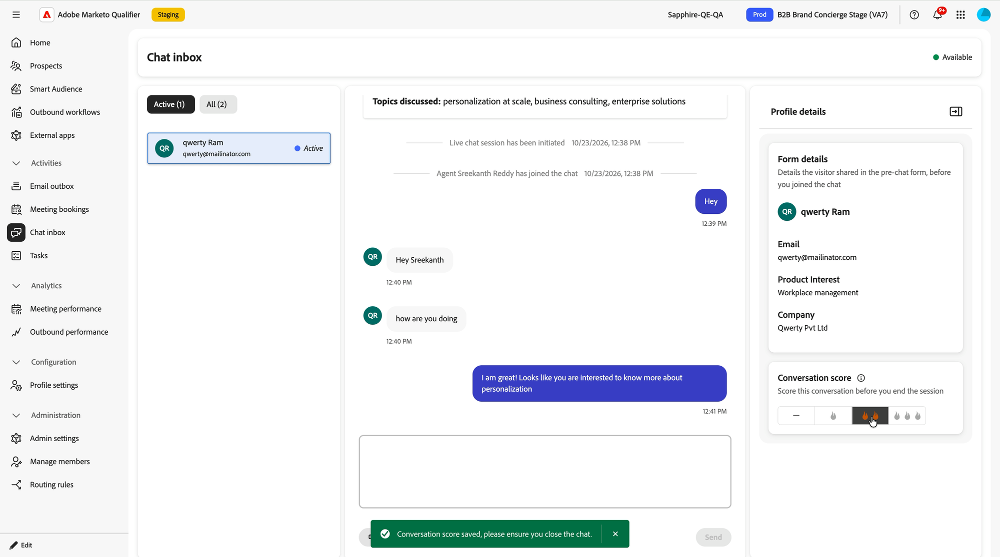

# Handle live chats in the chat inbox {#chat-inbox}

When a visitor asks to speak to someone, the chat arrives in the **[!UICONTROL Chat inbox]** in [!DNL Adobe Marketo Qualifier]. This page is the representative's view of a live chat: what you see when it arrives, what context you get, and what you have to do before you can close it.

To open it, in the left panel under **[!UICONTROL Activities]**, select **[!UICONTROL Chat inbox]**.

## Receive a chat {#receive}

Your status appears in the top-right corner of the inbox. **[!UICONTROL Available]** means you can receive chats now. Your live chat availability hours decide whether you are eligible at all; see [Set live chat availability](representative-setup.md#chat-availability).

How a chat reaches you depends on the routing type set on the **[!UICONTROL Live Chat]** integration:

* With round robin, every eligible representative is notified at the same time and the first to accept takes the conversation.
* With direct agent, the chat always comes to the named representative.
* With custom routing, the chat goes to the representatives assigned to the highest-priority rule the visitor matched.

Two tabs organize your conversations:

* **[!UICONTROL Active]** — conversations currently in progress.
* **[!UICONTROL All]** — every conversation, including ones that have ended.

## Pick up the conversation {#pick-up}

You never start cold. Before you type anything, the inbox gives you everything the visitor already told the concierge.

{width="800" zoomable="yes"}

| What you see | What it gives you |
| --- | --- |
| **[!UICONTROL Visitor conversation recap]** | A **[!UICONTROL Summary]** of the conversation the visitor had with the concierge, and the **[!UICONTROL Topics discussed]** |
| Conversation transcript | The full exchange with the concierge, above the point where live chat was initiated |
| **[!UICONTROL Form details]** | What the visitor entered in the pre-chat form before you joined, such as email, product interest, and company |

The transcript marks the handoff with two system lines, `Live chat session has been initiated` and `Agent <name> has joined the chat`, so you can always tell which part of the conversation was the concierge and which part is yours.

Type in the message box and select **[!UICONTROL Send]** to reply.

{width="800" zoomable="yes"}

## Score the conversation {#conversation-score}

Before you end a chat, rate how qualified the visitor is. The score is set by you, the representative who actually spoke to the visitor, which is what makes it trustworthy downstream.

In the **[!UICONTROL Profile details]** panel, under **[!UICONTROL Conversation score]**, select a rating. The dash means no score, and the flame icons rate the conversation from least to most qualified.

{width="600" zoomable="yes"}

| Selection | Stored value | Meaning |
| --- | --- | --- |
| Dash | 0 | Least qualified |
| One flame | 1 | Somewhat qualified |
| Two flames | 2 | Qualified |
| Three flames | 3 | Most qualified |

>[!IMPORTANT]
>
>Scoring is mandatory. If you try to close a chat without scoring it, the error `Please score the conversation before you close the chat` appears and the chat stays open. After you score it, a confirmation appears and you can close the chat.

{width="800" zoomable="yes"}

The score is written to the **[!UICONTROL Engage with Live Chat in Concierge]** activity in [!DNL Marketo Engage], where it is available as a constraint on filters and triggers. Use it to drive retargeting, lead scoring, personalization, and CRM handoff. See [Brand Concierge data in Marketo Engage](marketo-activities.md).

## End the chat {#end-chat}

Select **[!UICONTROL End chat]** to close the conversation. The visitor can also end it from their side, and is asked to confirm first.

When a chat closes, its conversation status is recorded as one of two values:

* **Ended** — the conversation was closed deliberately, by you or by the visitor.
* **Dropped** — the visitor left the site and the conversation timed out from inactivity.

>[!NOTE]
>
>Live chat conversations are retained for 30 days.

## Next step {#next}

See what all of this writes back to your marketing database in [Brand Concierge data in Marketo Engage](marketo-activities.md).
