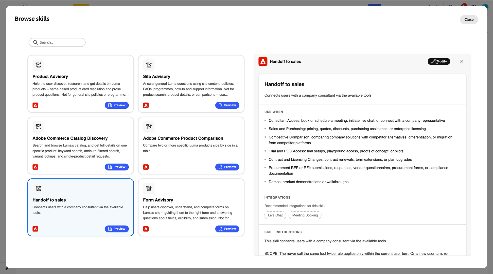

# Add live chat and meeting booking to a concierge {#configure-in-composer}

Two things have to be in place in Composer. The **[!UICONTROL Meeting Booking]** and **[!UICONTROL Live Chat]** integrations give the concierge the *ability* to check availability, start a chat, and book a slot. The **[!UICONTROL Handoff to sales]** skill tells it *when* to use that ability.

>[!NOTE]
>
>Complete [Set up representatives in Adobe Marketo Qualifier](representative-setup.md) first. The integrations check for connected calendars and live chat availability, and will not activate without them.

## Connect the Meeting Booking integration {#connect-meeting-booking}

1. In Composer, open your concierge and select **[!UICONTROL Integrations]** > **[!UICONTROL Browse integrations]**.

   **[!UICONTROL Meeting Booking]** and **[!UICONTROL Live Chat]** appear under **[!UICONTROL Built-in Integrations]**.

   {width="800" zoomable="yes"}

1. Select **[!UICONTROL Meeting Booking]**, and then select **[!UICONTROL Configure]**.

1. Enter a name and description.

   Name the integration for what it does in this concierge, such as `Meeting booking - US region` or `Meeting booking - round robin`. You can connect more than one, so the name is how you tell them apart later.

1. Check the calendar connection status.

   The integration verifies that at least one representative in your organization has connected a calendar.

   * If none has, an error tells you to connect at least one calendar before activating meeting booking. Go back to [!DNL Adobe Marketo Qualifier] and complete [Connect your calendar](representative-setup.md#connect).
   * If at least one has, a confirmation shows that representatives are available.

1. Select a routing type: **[!UICONTROL Round robin]**, **[!UICONTROL Direct agent]**, or **[!UICONTROL Custom routing]**.

   If you select **[!UICONTROL Direct agent]**, choose the representative who receives every meeting booked through this concierge. If you select **[!UICONTROL Custom routing]**, the routing rules you built in [!DNL Adobe Marketo Qualifier] are applied. For how each behaves, see [Route conversations to representatives](routing-rules.md).

1. Select **[!UICONTROL Connect]**.

## Connect the Live Chat integration {#connect-live-chat}

1. In **[!UICONTROL Browse integrations]**, select **[!UICONTROL Live Chat]**, and then select **[!UICONTROL Configure]**.

1. Enter a name and description, for example `Live chat - round robin`.

1. Check the live chat availability status.

   The integration verifies that at least one representative has set live chat availability.

   * If none has, a message tells you to add representatives who have set up their live chat availability. Go back to [!DNL Adobe Marketo Qualifier] and complete [Set live chat availability](representative-setup.md#chat-availability).
   * If at least one has, a confirmation shows that representatives are available.

1. Select a routing type.

   Live chat supports the same three routing types as meeting booking. With **[!UICONTROL Round robin]**, every eligible representative is notified at once and the first to accept takes the chat.

1. Select **[!UICONTROL Connect]**.

## Activate the Handoff to sales skill {#activate-skill}

The integrations are now connected, but the concierge still needs to know when to offer them. That is the skill's job.

1. In Composer, select **[!UICONTROL Skills]** > **[!UICONTROL Browse skills]**, and then select **[!UICONTROL Handoff to sales]**.

   The detail panel shows the skill description, its **[!UICONTROL Use when]** conditions, the recommended **[!UICONTROL Integrations]**, and the **[!UICONTROL Skill instructions]**.

   {width="800" zoomable="yes"}

1. Select **[!UICONTROL Modify]**.

   {width="800" zoomable="yes"}

1. Review the skill name and description, and edit them if you want.

1. Review the **[!UICONTROL Use when]** conditions.

   These are the intents that trigger a handoff. The skill ships with a default set:

   | Condition | Triggers on |
   | --- | --- |
   | Consultant Access | Booking or scheduling a meeting, starting a live chat, or asking to connect with a company representative |
   | Sales and Purchasing | Pricing, quotes, discounts, purchasing assistance, or enterprise licensing |
   | Competitive Comparison | Comparing your solutions with competitor alternatives, differentiation, or migration from a competitor platform |
   | Trial and POC Access | Trial setups, playground access, proofs of concept, or pilots |
   | Contract and Licensing Changes | Contract renewals, term extensions, or plan upgrades |
   | Procurement RFP or RFI | Submissions, responses, vendor questionnaires, procurement forms, or compliance documentation |
   | Demos | Product demonstrations or walkthroughs |

   Select **[!UICONTROL Add condition]** to add an intent of your own, or delete any condition that does not apply to your business.

1. Add the integrations you connected.

   Add **[!UICONTROL Live Chat]**, **[!UICONTROL Meeting Booking]**, or both, depending on what you want this concierge to offer.

1. Review the **[!UICONTROL Skill instructions]**.

   The instructions are generated for you from the conditions and integrations you selected, so in most cases no editing is needed.

   Edit them in plain language when you want finer control over which intent leads to which option. For example, you can instruct the concierge to offer live chat for pricing questions, offer a meeting for demo requests, and offer both for procurement questions.

1. Select **[!UICONTROL Save]**.

## Test and publish {#test-and-publish}

Open the preview and ask the concierge something that matches one of the **[!UICONTROL Use when]** conditions, such as requesting a demo. The concierge should offer to connect you with a specialist, show the chat option, the meeting option, or both, and present real availability.

When the behavior is right, publish your concierge to make the handoff live on your site.

## Next step {#next}

Your representatives can now receive chats. See [Handle live chats in the chat inbox](chat-inbox.md).
